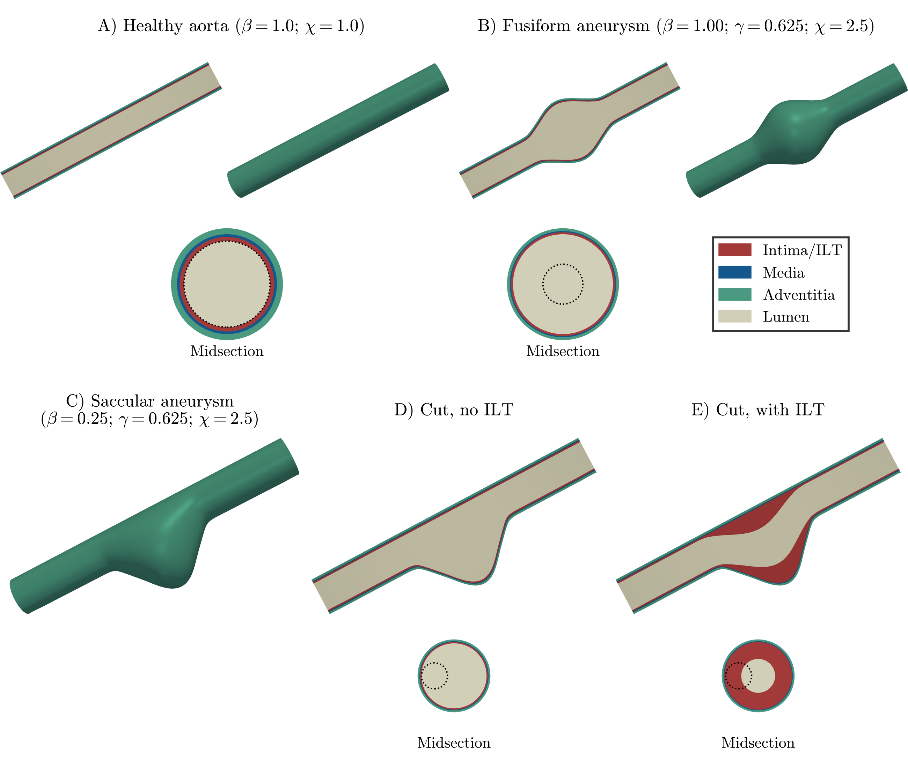
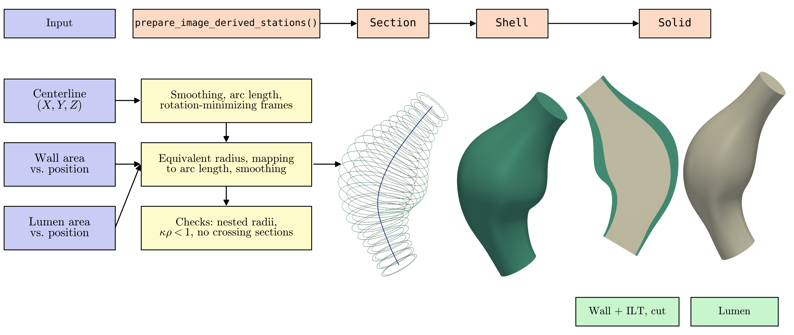
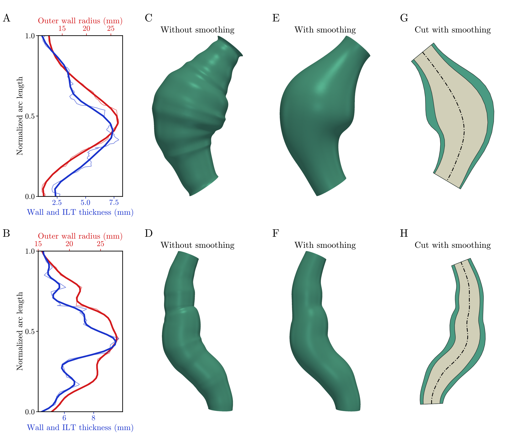

<p align="center">
  
</p>

<p align="center">
  <b>Parametric, simulation-ready geometries of abdominal aortic aneurysms with SALOME</b>
</p>

<p align="center">
  <a href="LICENSE.txt"></a>
  
  
</p>

# AneuPy

AneuPy generates parametric, simulation-ready geometries of abdominal aortic aneurysms (AAA) with the
Python interface of the [SALOME platform](https://www.salome-platform.org/). The solids are intended for
finite element analysis (FEA), computational fluid dynamics (CFD) and fluid-structure interaction (FSI) studies.

## Contents

- [What AneuPy is for](#what-aneupy-is-for)
- [Requirements](#requirements)
- [Quick start](#quick-start)
- [Conventions](#conventions)
- [Idealized models](#idealized-models)
- [Image-derived parametric models](#image-derived-parametric-models)
- [Output](#output)
- [Checks and limits](#checks-and-limits)
- [Building your own pipeline](#building-your-own-pipeline)
- [Repository layout](#repository-layout)
- [Tests](#tests)
- [Citing AneuPy](#citing-aneupy)
- [License](#license)

## What AneuPy is for

AneuPy builds families of geometries in which each morphological variable can be changed on its own, for
example in sensitivity analyses, parametric studies or the verification of solvers. It offers:

- **Idealized models**: a straight reference axis, circular sections, equal necks and uniform wall layers, all
  prescribed by parameters and not derived from any patient. See [Idealized models](#idealized-models).
- **Image-derived parametric models**: a centerline and area profiles measured from images, reconstructed with
  circular sections concentric to the centerline. See [Image-derived models](#image-derived-parametric-models).

Both kinds of model can include:

- A multilayer arterial wall (intima, media and adventitia in idealized models).
- An intraluminal thrombus (ILT) of prescribed thickness.
- Asymmetric sacs, by shifting the centre of the dilated section.
- Automatic geometric checks that stop or warn before an invalid solid is produced.
- Export to STEP, IGES, STL, VTK and BREP, ready for meshing.

> [!IMPORTANT]
> **AneuPy is not a patient-specific modelling tool.** Circular sections keep the measured area but not the
> shape of a section, and the thrombus has no circumferential variation. To predict the stress of an individual
> patient from a segmentation, use a tool that keeps the segmented surface, such as
> [BioPARR](http://bioparr.mech.uwa.edu.au/).

## Requirements

- **SALOME 9.11**, which provides Python 3.6, NumPy, SciPy and the GEOM module. No installation is needed inside
  SALOME, because the examples add the repository to the Python path. The geometry module also supports the
  import layout of recent SALOME versions.
- The layers of `aneupy` other than `aneupy.geometry` need only NumPy and SciPy. `pip install` requires
  Python 3.7 or later.

## Quick start

```bash
git clone https://github.com/mdeluci/AneuPy.git
cd AneuPy/examples
export SALOME_ROOT_DIR=/path/to/SALOME-9.11.0
./run_in_salome.sh idealized_automatic.py
```

`run_in_salome.sh` runs a script with SALOME's Python, so the GEOM module is available. Replace
`/path/to/SALOME-9.11.0` with the folder where SALOME is installed. The generated solids are written to the
output folder of the example and can be opened in SALOME or in any CAD or meshing tool.

## Conventions

| Item | Convention |
| --- | --- |
| Length, area | Millimetres, square millimetres |
| Coordinates | Right-handed Cartesian. The axis of an idealized model is global Z |
| Section | Defined in the XY plane of its local system, whose Z axis is the section normal |
| Circle seam | On the local X axis |
| Arc length | Measured along the processed centerline, from its first point |
| Exported files | STEP and IGES carry the physical size. STL, VTK and BREP store millimetres without units |

## Idealized models

<p align="center">
  
</p>

<p align="center"><sub>
<b>Idealized geometries generated with <code>build_idealized_model</code>.</b>
(A) Healthy aorta. (B) Fusiform aneurysm. (C) Saccular aneurysm. (D) Cut view of (C) without intraluminal
thrombus (ILT). (E) Cut view of (C) with a 6 mm ILT. All models have a 10 mm neck diameter, a total length of
100 mm, and layers of 0.5, 0.3 and 0.7 mm. The dotted lines superimposed on the circular cross sections indicate
the non-dilated lumen.
</sub></p>

The radius, thrombus thickness and centre shift follow one shape function, with `zc` the model mid-length:

```text
w(z) = cos^2(pi (z - zc) / LAAA)   inside the sac, and 0 in the necks
```

`w` is 1 at the midsection and falls smoothly to 0 where the sac meets the necks, so the radius, thrombus
and centre shift all vary continuously and without kinks.

### Parameters

| Parameter | Meaning |
| --- | --- |
| `length` | Total model length, including both necks |
| `radius_nondilated` | Lumen radius of the necks |
| `radius_dilated` | Radius of the vessel lumen at the midsection, before any thrombus |
| `wall_thickness_intima`, `wall_thickness_media`, `wall_thickness_adventitia` | Layer thicknesses |
| `ilt_thickness` | Thrombus thickness at the midsection |
| `x_shift`, `y_shift` | Offset of the midsection centre from the Z axis |
| `sac_fraction` | `LAAA / length` |
| `section_spacing` | Axial distance between sections (5 mm by default) |

Setting `radius_dilated` equal to `radius_nondilated` gives a healthy aorta. Increasing it gives a fusiform
aneurysm, and adding `x_shift` or `y_shift` makes the sac asymmetric (saccular).

### From Python

The dimensionless descriptors can be used directly:

```python
from aneupy import IdealizedParameters, build_idealized_model, export_solids
from aneupy.geometry import Domain

parameters = IdealizedParameters.from_descriptors(beta=0.2, gamma=0.625, chi=2.5, neck_diameter=20.0)
domain = Domain()
names = build_idealized_model(domain, parameters)
export_solids(domain, names, "output")
```

### From the command line

Models defined by their dimensions are also available from the command line. Any parameter in the JSON file
can be overridden with a flag:

```bash
./run_in_salome.sh aneupy_cli.py idealized --config params_idealized_automatic.json --x_shift 0 --output-dir output
```

The intima and any thrombus form one solid, `aneurysm_intima_ILT`.

## Image-derived parametric models

<p align="center">
  
</p>

<p align="center"><sub>
<b>Workflow of the image-derived pipeline.</b> Inputs become checked sections, sections become a surface, and
surfaces become solids.
</sub></p>

### Input data

| File | Columns | Separator |
| --- | --- | --- |
| Centerline | X, Y, Z in mm, ordered along the vessel | Commas and/or whitespace |
| Wall area | Axial position, area in mm2 enclosed by the outer wall | Commas and/or whitespace |
| Lumen area | Axial position, lumen area in mm2 | Commas and/or whitespace |

AneuPy does not process images. A segmentation of lumen and outer wall is needed first. With
[3D Slicer](https://www.slicer.org/) and its
[SlicerVMTK extension](https://github.com/vmtk/SlicerExtension-VMTK), the *Extract Centerline* module provides
the centerline and the *Cross-Section Analysis* module measures the area along it. VMTK offers the same
operations from its own tools. The sample files in `examples/data` have this format; please see the article
for their source.

### Processing

1. The centerline is smoothed and reparameterized by arc length (`centerline_cutoff`).
2. Both area profiles become equivalent radii, `R = sqrt(A / pi)`, and map linearly onto arc length over their
   common abscissa range. `flip_profiles` selects which end corresponds to the first abscissa.
3. Both radii are smoothed (`profile_cutoff`). Oscillations of this wavelength in mm keep half of their amplitude.
4. All quantities are sampled at uniformly spaced sections (`n_sections`).
5. The limits in [Checks and limits](#checks-and-limits) are checked and, when they hold, lumen and `wall_ilt`
   solids are built.

Area profiles cannot separate wall from thrombus, so `wall_ilt` contains both.

### Processing parameters

| Parameter | Meaning |
| --- | --- |
| `centerline_cutoff` | Smoothing wavelength of the centerline, in mm |
| `profile_cutoff` | Smoothing wavelength of the radius profiles, in mm |
| `flip_profiles` | Reverses which end of the centerline the first abscissa of the area profiles corresponds to |
| `n_sections` | Number of uniformly spaced sections used to build the surfaces |

Larger cutoffs give smoother surfaces but remove more of the measured detail. The figure below shows the effect
of smoothing on two image-derived models.

<p align="center">
  
</p>

<p align="center"><sub>
<b>Image-derived parametric models.</b> (A, B) Outer wall radius and wall-and-ILT thickness vs. normalized arc
length: input data (thin lines) and sections after smoothing (thick lines). (C, D) Outer surfaces without
smoothing. (E, F) Outer surfaces with smoothing. (G, H) Cuts through the plane of the centerline, showing the
lumen, the wall and ILT, and the centerline (dash-dotted).
</sub></p>

## Output

| Model | Solids |
| --- | --- |
| Idealized | One solid per wall layer; the intima and any thrombus form `aneurysm_intima_ILT` |
| Image-derived | `lumen` and `wall_ilt` (wall and thrombus together) |

Each solid is exported as a separate file in STEP, IGES, STL, VTK or BREP format. STEP and IGES carry the
physical size; STL, VTK and BREP store millimetres without units.

Solids are exported separately, so the interfaces between layers coincide geometrically but do not share a mesh.
For a conformal mesh, partition or fragment the solids in the mesher (for example with *Partition* in SALOME's
GEOM module or *BooleanFragments* in Gmsh).

## Checks and limits

AneuPy stops with a `GeometryError`, or warns with a `GeometryWarning`, when the input approaches these limits:

| Limit | Check | Result |
| --- | --- | --- |
| Tight bends (image-derived models) | `curvature x radius < 1` along the centerline | Error, with a warning above 0.8 |
| Folded sections (all shells) | Discs of different sections must not intersect | Error |
| Section order (all shells) | Sections must advance monotonically along their normals | Error |
| Crossing boundaries (image-derived and idealized models) | Lumen inside the outer wall at every section | Error, with a warning below 0.1 mm |
| Failed surface fit (all solids from shells) | Solid volume against the volume implied by the sections | Warning above 1%, error above 5% |
| Boolean cuts (all cuts) | Material must remain, and the removed solid should lie inside the other | Error, or a warning |
| Malformed tables | Columns and numbers (file and line); positive areas (file and row); sorted positions | Error or warning |
| Non-circular sections | Not supported: inputs provide only an area for each position | Not expressible |

### Common fixes

| Message about | Try |
| --- | --- |
| Tight bends or folded sections | Increase `centerline_cutoff`, or reduce `n_sections` so sections are further apart |
| Crossing boundaries | Increase `profile_cutoff`, or check that the wall and lumen files belong to the same vessel and orientation (`flip_profiles`) |
| Failed surface fit | Increase `n_sections` (or reduce `section_spacing`) so the surface follows the sections more closely |
| Malformed tables | Open the reported file at the reported line and check the column count, separators and units |

## Building your own pipeline

The ready-made builders are short functions over reusable blocks. `add_lofted_solid` turns a list of `Station`
into a solid, and `add_layered_solids` adds concentric layers. `examples/custom_pipeline.py` runs an asymmetry
sweep with a user-defined two-layer wall. See [the API reference](docs/api.md).

## Repository layout

```text
AneuPy/
├── src/aneupy/          Python package (aneupy.geometry needs SALOME; the rest needs only NumPy and SciPy)
├── docs/api.md          API reference
├── examples/
│   ├── run_in_salome.sh     Runs a script with SALOME's Python
│   ├── idealized_automatic.py
│   ├── aneupy_cli.py        Command-line interface
│   ├── custom_pipeline.py   Asymmetry sweep with a user-defined wall
│   └── data/                Sample centerline and area files
├── figures/             Figures used in this README
├── tools/salome_shim/   OpenCASCADE implementation of GEOM operations, for tests
└── LICENSE.txt
```

## Tests

```bash
pip install -e .[test] "cadquery-ocp<8"
pytest
```

Tests run without SALOME: `tools/salome_shim` implements the GEOM operations used by AneuPy with OpenCASCADE.
The shim is a verification instrument. Please confirm final geometries in SALOME.

## Citing AneuPy

If you use AneuPy in your research, please cite the accompanying article:

```bibtex
@misc{delucio2025aneupyopensourcepython,
      title={AneuPy: An open source Python tool for creating simulation-ready geometries of abdominal aortic aneurysms}, 
      author={Mario de Lucio and Jacobo Diaz and Alberto de Castro and Luis E. Romera},
      year={2025},
      eprint={2504.15285},
      archivePrefix={arXiv},
      primaryClass={physics.med-ph},
      url={https://arxiv.org/abs/2504.15285}, 
}
```

## Contributing

Bug reports and suggestions are welcome through
[GitHub Issues](https://github.com/mdeluci/AneuPy/issues). Please include the AneuPy version, the SALOME
version and, if possible, the input files that reproduce the problem.

## License

AneuPy is released under the GNU General Public License, version 3 or later. See [LICENSE.txt](LICENSE.txt).